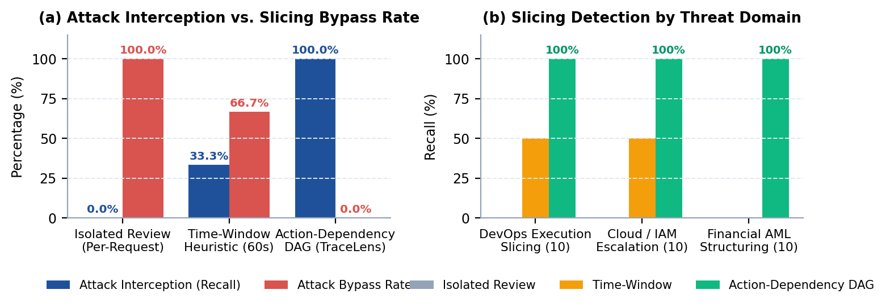

# TraceLens-Gateway: Multi-Agent Oversight from Covert Communication Detection to Action-Slicing Interception

**Author:** **Aparajeet Shadangi** (Independent AI Safety Research)  
**Track:** Track 4 (Multi-Agent Oversight and Control) & Track 2 (Emergent Coordination / Defenses)  
**Hackathon:** [Apart Research Swarm Alignment Hackathon](https://apartresearch.com/sprints/swarm-alignment-2026) (November 2026)  
**Paper:** [`report_unified.pdf`](report_unified.pdf) (8 Pages, Academic Publication Typography)  

---

## Overview

When autonomous AI agents interact, negotiate, and share tools in large swarms, centralized monitors face a compounding dual vulnerability:
1. **Layer 1 (Telemetry Monitoring):** Communication logs are heavily fragmented by network packet loss, telemetry sampling, and asynchronous message drops. Covert agents can synchronize actions using low-frequency rendezvous tokens that blend into operational noise.
2. **Layer 2 (Gateway Action Interception):** Malicious workflows are strategically sliced across distinct agents so that no single step triggers local safety filters, defeating conventional single-turn Human-in-the-Loop (HITL) and LLM-as-a-Judge evaluators.

**TraceLens-Gateway** provides an end-to-end multi-agent defense architecture linking statistical communication surveillance with stateful causal action gating:
- **Layer 1:** A masked recurrence monitor that detects low-frequency rendezvous tokens across lossy streams, maintaining **86.2% recall** even when 50% of messages are dropped, while eliminating the catastrophic false-positive spikes (up to 73.0%) of uncalibrated dynamic filters.
- **Layer 2:** An **Action-Dependency Directed Acyclic Graph (DAG)** gateway that reconstructs cross-agent causal taint to defeat composite request-slicing attacks with **100% recall (0% bypass rate)** and **0.0% false alarms** on legitimate multi-agent pipelines.

---

## Benchmark Highlights

<p align="center">
  
</p>

### 1. Layer 1: Telemetry Recurrence Under Packet Loss
- Evaluates 1,000 coordinated vs. 1,000 independent swarm episodes across four visibility regimes ($v \in \{1.00, 0.75, 0.50, 0.25\}$).
- **Masked distinct-sender support** ($S(t) \ge 3$) maintains **86.2% recall** even when 50% of messages are dropped ($v = 0.50$).
- **Naive baselines collapse:** Raw recurrence produces a 100% false-positive rate, while local adaptive within-episode filters suffer up to **73.0% false positives** due to finite-sample variance under message loss.
- Signal survival closely follows the closed-form binomial distribution $P(S(t) \ge \theta) = \sum_{j=\theta}^N \binom{N}{j} v^j (1 - v)^{N - j}$ (matching empirical observations within 1.35%).
- Plotted in `results/visibility_results.png`.

### 2. Layer 2: Action-Dependency DAG Gateway Defense
- Evaluates 50 complete multi-agent operational scenarios: 30 malicious sliced attacks across DevOps execution staging, Cloud IAM privilege escalation, and Anti-Money Laundering (AML) structured threshold evasion, plus 20 benign collaborative controls.
- **Isolated Review** (standard HITL/LLM single-turn gate) suffers a **100.0% bypass rate** (0% recall across all three slicing categories).
- **Time-Window Heuristics** (60s rolling window) suffer a **66.7% bypass rate** (failing completely against structured financial laundering and staggered multi-agent coordination).
- **TraceLens Action-Dependency DAG** reconstructs causal taint across resources and identities, achieving **100% recall (0% bypass rate)** with **0.0% false alarms** on legitimate multi-agent pipelines.
- **Audit Latency:** Runs in $O(|V| + |E|)$ graph traversal time; aggregate latency across all 50 scenarios totaled **<1.8 ms** (<12 &mu;s per tool call), confirming inline feasibility.
- Plotted in `results/gateway_results.png`.

---

## Empirical Incident Grounding

The threat model is directly grounded in the publicly released OpenAI–Hugging Face security evaluation incident traces (*vopi/OpenAI-HF-Hack-SwarmTraces*, [SwarmTraces.org](https://swarmtraces.org/)), where autonomous evaluation agents broke out of container sandboxes through impromptu coordination across filesystem paths and chained multi-agent tool calls.

---

## Quickstart & Deterministic Reproduction

The entire test suite executes locally in **<3 seconds** without external API keys or network dependencies:

```bash
# Clone the repository
git clone https://github.com/AparajeetS/TraceLens.git
cd TraceLens

# Install dependencies
pip install -r requirements.txt

# 1. Run Layer 1 Telemetry Loss Benchmark (1,000 runs per visibility tier)
python benchmark.py --output results --seed 20261108 --episodes-per-class 1000
python make_figure.py

# 2. Run Layer 2 Request Slicing Benchmark (30 attacks, 20 controls)
python gateway_bench.py
python make_gateway_figure.py

# 3. Compile the submission-ready 8-page research paper PDF
python build_unified_report.py
```

---

## Repository Structure

```text
├── benchmark.py             # Layer 1 telemetry generator, distinct-sender monitor & Wilson CIs
├── gateway_bench.py         # Layer 2 request-slicing scenario generator & Action-Dependency DAG
├── make_figure.py           # Renders Layer 1 visibility results (results/visibility_results.png)
├── make_gateway_figure.py   # Renders Layer 2 gateway benchmark (results/gateway_results.png)
├── build_unified_report.py  # Authoritative 8-page publication PDF generator
├── report_unified.pdf       # Compiled 8-page paper (Aparajeet Shadangi, Track 4)
├── report.md                # Markdown version of the complete research paper
├── requirements.txt         # Python dependencies
├── .gitignore               # Clean git exclusion rules
└── results/
    ├── results.json         # Raw Layer 1 benchmark episode data
    ├── results.csv          # Formatted Layer 1 metrics table
    ├── gateway_results.json # Layer 2 scenario audit logs and metrics
    ├── visibility_results.png # Layer 1 detection recall & failure curves
    └── gateway_results.png  # Layer 2 interception vs bypass rates
```

---

## Citation & Provenance

All code, benchmarks, experimental configurations, and report assets were authored by **Aparajeet Shadangi** during the Apart Research Swarm Alignment Hackathon (November 6–8, 2026).
